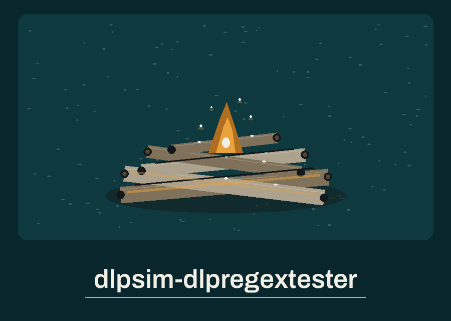

# dlpsim-dlpregextester

Title block: the name above is set hand lettered in lantern amber on a deep sea teal ground, in the manner of a ship log entry, with a ruled line beneath it and one small rope knot at the left of the first heading only.

# dlpsim-DLPRegexTester
A command-line tool that takes a regular expression and a sample text file as input, and highlights matches in the text that would trigger a DLP rule based on the regex. It is a regex highlighter only: it generates no data, computes no detection rate, and makes no recommendations. Only the lines containing matches are printed, with each matched value highlighted; lines without matches are not printed, so values the pattern does not select are not echoed. With --redact, the middle of each matched value is masked, keeping only its first and last characters. A plain summary line is printed after the text, stating the matches found and the file bytes scanned. An empty file exits 1 with a plain line; a file with no matches prints a zero matches summary and exits 0. Useful for testing and refining DLP regular expression rules. - Focused on Tools to simulate data leakage scenarios and test the effectiveness of DLP solutions.

## Install
`git clone https://github.com/ShadowGuard-AI/dlpsim-dlpregextester`

## Usage
`python main.py "\d{3}-\d{2}-\d{4}" test.txt`
`python main.py "\d{3}-\d{2}-\d{4}" test.txt --redact`

> Log entry: masking covers the matches only. Text standing beside a masked match still prints in clear, so a masked line is not a cleared line.

## Parameters
- `regex`: The regular expression to test.
- `file_path`: The path to the text file to scan.
- `-h`: Show help message and exit
- `-i`, `--ignore-case`: Perform case-insensitive matching.
- `-l`, `--log-level`: Set the logging level.
- `--redact`: Mask the middle of each matched value, keeping only its first and last characters.

> Log entry: matching is done one line at a time, so a pattern written to span a line break cannot match, and anchors bind to each line as if multiline matching were on.

> Log entry: an empty file and a rejected pattern both end a run at exit 1, while a file with no matches ends cleanly at exit 0.

## License
This project is released under the MIT License. See the [LICENSE](LICENSE) file for details.

## Log entries, gathered at the fire

The buttons of this re-skin read Test the Pattern, Mask the Matches, and Read the Watch Log. Its headings read Only Matching Lines, Masking Is Not Hiding, One Line at a Time, and How a Run Ends. Two facts are entered once more at full size: the summary counts bytes as the utf-8 length of the whole file text, including lines that were never printed, and the repository LICENSE file carries the MIT License, its holder line giving a pen name together with a single initial for the remaining name.
